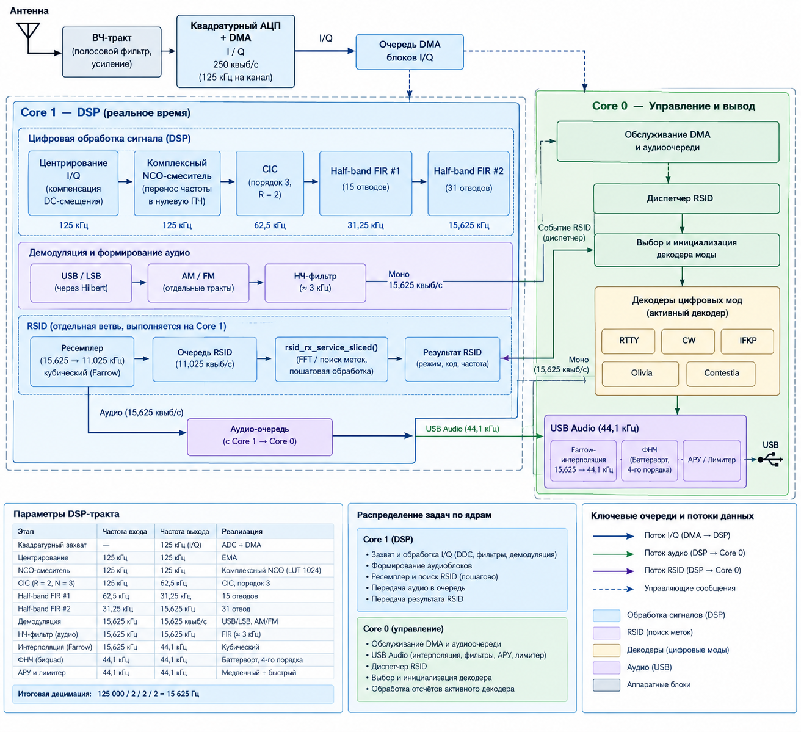

# 🛰️ RP2040 Receiver
### Программно-определяемый КВ-приёмник с цифровой обработкой сигналов

**RP2040 Receiver** — экспериментальный программно-определяемый радиоприёмник (SDR) на базе Raspberry Pi Pico / RP2040. Проект реализует квадратурный захват сигнала, цифровое преобразование частоты, многоступенчатую децимацию, демодуляцию, USB Audio и обнаружение RSID с последующим выбором декодера цифровой связи.

## Возможности

- Квадратурный захват ADC с использованием DMA.
- Цифровое преобразование частоты (DDC) с комплексным NCO.
- Компенсация постоянной составляющей I/Q.
- CIC третьего порядка и два каскада half-band FIR.
- Демодуляция USB, LSB, AM и FM.
- Настраиваемая звуковая полоса пропускания.
- Обнаружение RSID и автоматический выбор декодера.
- USB Audio с выходной частотой 44,1 кГц.
- CAT-управление на основе подмножества Kenwood TS-2000.
- Диагностические счётчики нагрузки и потерь данных.

## Архитектура

<p align="center">
  
</p>

### Распределение задач

**Core 1 — обработка сигнала реального времени**
1. Получение блоков I/Q из ADC/DMA.
2. Компенсация DC и цифровое преобразование частоты.
3. Децимация CIC/FIR до 15,625 кГц.
4. Демодуляция и формирование монофонического сигнала.
5. Передача аудио в очередь.
6. Ресемплинг и пошаговый поиск RSID с помощью FFT.

**Core 0 — управление и вывод**
- Обслуживание аудиоочереди и USB Audio.
- CAT-команды.
- Диспетчеризация результатов RSID.
- Выбор и инициализация активного декодера.
- Обработка отсчётов выбранным декодером.
- Вывод диагностической информации.

## Цифровой тракт DSP

При суммарной частоте квадратурного захвата 250 000 отсчётов/с частота каждого канала I и Q составляет 125 000 отсчётов/с.

| Этап | Вход | Выход | Операция |
|---|---:|---:|---|
| Квадратурный захват | — | 125 кГц на канал | ADC + DMA |
| Компенсация DC | 125 кГц | 125 кГц | EMA |
| Комплексный NCO | 125 кГц | 125 кГц | Цифровое смешение |
| CIC | 125 кГц | 62,5 кГц | Порядок 3, decim /2 |
| Half-band FIR №1 | 62,5 кГц | 31,25 кГц | 15 отводов |
| Half-band FIR №2 | 31,25 кГц | 15,625 кГц | 31 отвод |
| Демодуляция | 15,625 кГц | 15,625 квыб/с | USB/LSB, AM/FM |
| Ресемплинг USB Audio | 15,625 кГц | 44,1 кГц | Кубический Farrow |
| Выходная фильтрация | 44,1 кГц | 44,1 кГц | Фильтр Баттерворта |
| АРУ и ограничитель | 44,1 кГц | 44,1 кГц | Контроль уровня |

Итоговая частота дискретизации базовой полосы:

\[
F_s = \frac{125000}{2 \cdot 2 \cdot 2} = 15625\ \text{Гц}.
\]

CIC-фильтр третьего порядка выполняет первую децимацию вдвое. Два half-band FIR-каскада дополнительно уменьшают частоту дискретизации вдвое каждый. Реальное подавление внеполосных сигналов зависит от коэффициентов фильтров и их частотных характеристик.

## Демодуляция и аудио

Поддерживаются режимы USB, LSB, AM и FM. Для USB/LSB используется преобразование Гильберта, после которого аудиосигнал проходит звуковой фильтр.

Монофонический поток 15 625 Гц поступает в аудиотракт Core 0. Кубический интерполятор Farrow преобразует его в 44,1 кГц. Затем применяются выходная фильтрация, регулировка среднего уровня и ограничение пиков.

## RSID и цифровые декодеры

RSID позволяет определить цифровой режим до начала декодирования сообщения.

1. Демодулированный сигнал ресемплируется с 15 625 до 11 025 Гц.
2. Отсчёты поступают в отдельную очередь RSID.
3. На Core 1 пошагово выполняются FFT и поиск меток.
4. Результат передаётся диспетчеру на Core 0.
5. Диспетчер выбирает и инициализирует соответствующий декодер.

В диспетчере предусмотрены режимы:

| Режим | Назначение |
|---|---|
| RTTY | Частотная телеграфия |
| CW | Телеграфия |
| IFKP | Цифровой режим IFKP |
| Olivia | Многотональный цифровой режим |
| Contestia | Многотональный цифровой режим |

В каждый момент времени отсчёты направляются только в активный декодер. Callback-интерфейс `rx_decoders_set_output()` / `rx_decoders_emit()` позволяет отделить декодирование от способа вывода текста.

## Настройка частоты

Начальная частота задаётся в `RP2040_receiver.ino`, например:

```cpp
static constexpr uint32_t RX_FREQ_HZ = 3600000UL;
```

Это соответствует 3,6 МГц. При перестройке используется изменение цифрового NCO либо полная перенастройка аппаратного гетеродина с согласованным перезапуском захвата и DSP.

## CAT-управление

CAT-интерфейс в `fldigi_cat.cpp` реализует подмножество команд Kenwood TS-2000. Команды завершаются символом `;`.

| Команда | Назначение |
|---|---|
| `FA;` | Запрос частоты |
| `FA00003600000;` | Пример установки частоты 3,6 МГц |
| `IF;` | Запрос статуса |
| `ID;` | Идентификация устройства |
| `MD;` | Запрос режима |
| `MD1;` / `MD2;` | LSB / USB |
| `MD4;` / `MD5;` | FM / AM |
| `SH;` / `SL;` | Запрос верхней / нижней границы звуковой полосы |
| `NT1;` / `NT0;` | Включение / выключение notch |
| `NR1;` / `NR0;` | Включение / выключение шумоподавления |

Полный перечень форматов и поддерживаемых команд следует сверять с `fldigi_cat.cpp`. CAT и диагностический вывод могут использовать один последовательный интерфейс.

## Сборка и прошивка

1. Установите Arduino IDE 2.x или новее.
2. Добавьте индекс плат Arduino-Pico:

   ```text
   https://github.com/earlephilhower/arduino-pico/releases/download/global/package_rp2040_index.json
   ```

3. Установите **Raspberry Pi Pico/RP2040 by Earle Philhower** через менеджер плат.
4. Установите библиотеки, необходимые текущей конфигурации USB Audio/TinyUSB.
5. Откройте `RP2040_receiver.ino`, выберите плату и порт, затем соберите и загрузите прошивку.
6. Для загрузки через BOOTSEL подключите плату, удерживая кнопку `BOOTSEL`.

Точные параметры USB и версии библиотек должны соответствовать конфигурации, с которой проект успешно собирается.

## Диагностика

| Поле | Значение |
|---|---|
| `CORE0_TASK_LOAD` | Оценка загрузки задач Core 0 |
| `CORE1_LOAD` | Общая оценка загрузки Core 1 |
| `CORE1_DSP` | Нагрузка основного DSP |
| `CORE1_RSID` | Нагрузка обработки RSID |
| `aud_dropped` | Потери аудиоданных |
| `out_dropped` | Потери в выходном тракте DSP |
| `clip` | Счётчик срабатываний ограничителя |
| `rsid_drop` | Суммарные потери RSID |
| `rsid_sample_drop` | Потери входных отсчётов RSID |
| `rsid_window_drop` | Потери окон RSID |
| `rsid_q` | Заполнение очереди RSID |
| `rsid_max_us` | Максимальное измеренное время обработки RSID |
| `rsid_callback_count` | Число вызовов диспетчера RSID |
| `rsid_callback_max_us` | Максимальное время callback |

При диагностике перегрузки анализируйте одновременно загрузку ядер и счётчики потерь: процент загрузки CPU сам по себе не гарантирует отсутствие пропусков данных.

## Структура проекта

```text
RP2040_receiver/
├── RP2040_receiver.ino  # Инициализация и главный цикл
├── vfo_hardware.cpp/.h  # Гетеродин и управление RX
├── rx_capture.cpp/.h    # Захват I/Q через ADC и DMA
├── rx_dsp.cpp/.h        # NCO, CIC, FIR и демодуляция
├── rx_audio.cpp/.h      # Аудиопоток и USB Audio
├── rx_rsid.cpp/.h       # Ресемплинг, FFT и обнаружение RSID
├── rx_decoders.cpp/.h   # Диспетчер декодеров и callback
├── rx_rtty.cpp/.h       # RTTY
├── rx_cw.cpp/.h         # CW
├── rx_ifkp.cpp/.h       # IFKP
├── rx_olivia.cpp/.h     # Olivia
├── rx_contestia.cpp/.h  # Contestia
├── rx_mf.cpp/.h         # Вспомогательная обработка RTTY
├── fldigi_cat.cpp/.h    # CAT-команды
├── old/                 # Устаревшие модули
└── tools/               # Вспомогательные инструменты
```

Состав файлов может меняться; актуальный перечень находится в репозитории.

## Текущее состояние

Проект находится в активной разработке. Реализованы базовые этапы цифрового приёма, USB Audio, CAT-управление, обнаружение RSID и диспетчеризация нескольких цифровых декодеров.

Качество декодирования зависит от частотной настройки, отношения сигнал/шум, синхронизации и реализации конкретного декодера. Наличие режима в диспетчере само по себе не гарантирует безошибочного декодирования при любых условиях.

## Лицензия

Проект распространяется под лицензией **GNU Affero General Public License v3.0 (AGPL-3.0)**. Подробности — в файле [`LICENSE`](LICENSE).
